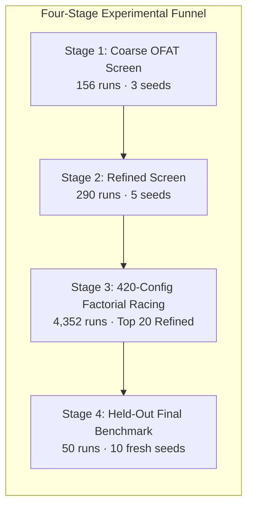
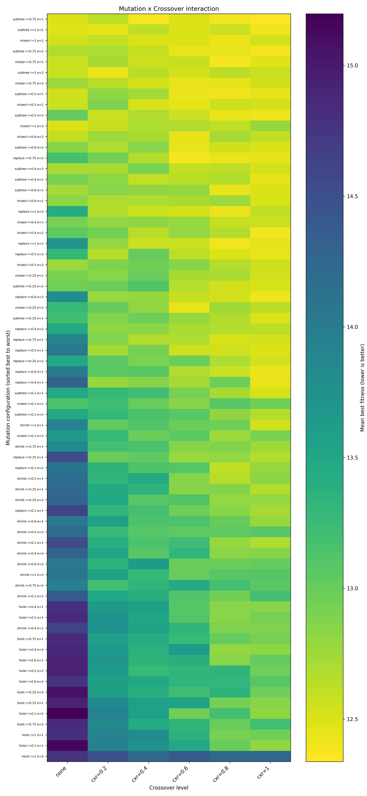
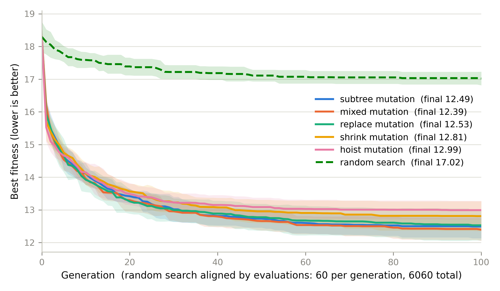
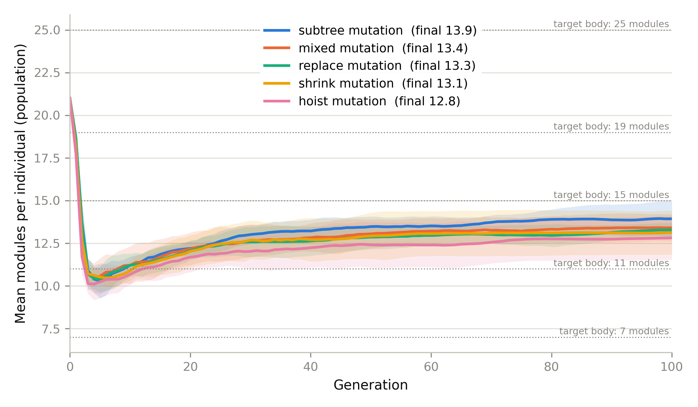
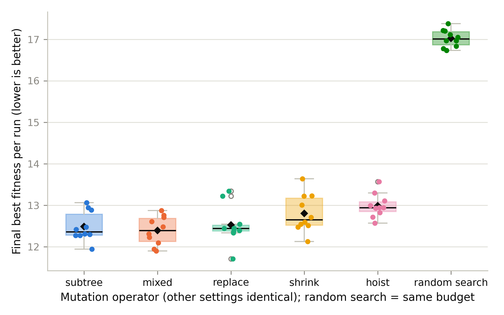

# Modular Robot Morphology Evolution via Tree Genomes

[](https://www.python.org/)
[](https://ci-group.github.io/ariel/)
[](https://cs.vu.nl/ci/)
[](./LICENSE)

> **Evolutionary Computing · Robot Morphology Evolution**  
> **Authors:** Siddhant Singh Bisht & Collaborators  
> **Affiliation:** Department of Computer Science, Vrije Universiteit Amsterdam  
> **Findings Report:** [`report/morphology_evolution_findings.md`](report/morphology_evolution_findings.md)

---

## 🤖 Executive Summary

This repository contains the complete experimental code, statistical analysis engine, and dataset for evolving **modular robot body phenotypes** using the [ARIEL](https://ci-group.github.io/ariel/) framework.

Using an expressive **Tree-Genome representation** (`ariel.ec.genotypes.tree.TreeGenome`), robot morphologies (composed of core modules, structural bricks, and active hinges) are evolved to match a target set of 5 diverse robotic morphologies (ranging from 7 to 25 modules). The objective is to minimise the **weighted Zhang–Shasha Tree Edit Distance (TED)** aggregated across all target bodies (Fitness = μ_TED + σ_TED).

Through an extensive four-stage experimental funnel spanning **>4,800 EA runs**—including a 420-configuration full-factorial screen with racing selection—we systematically analyze how **mutation operators** (`subtree`, `replace`, `mixed`, `shrink`, `hoist`) interact with **crossover rates** and **selection pressure** to govern structural bloat and morphological convergence.



---

## 🔬 Research Findings & Scientific Insights

| Aspect | Key Finding |
|---|---|
| **Constructive vs. Destructive Mutation** | **Constructive operators dominate.** Operators that inject novel genetic material (`mixed`: 12.39 ± 0.35, `subtree`: 12.49 ± 0.36, `replace`: 12.53 ± 0.46) significantly outperform purely reductive operators (`shrink`: 12.81 ± 0.46, `hoist`: 12.99 ± 0.29; subtree vs. hoist p = 0.007, Cliff's δ = -0.72). Destructive operators drive the population into premature structural atrophy (≈ 9–12 modules), failing to match larger targets (13–15 modules). |
| **Mutation × Crossover Interaction** | **Crossover rescues weak mutation.** Crossover is indispensable for relabeling and removal operators (yielding 1.3–1.9 fitness gains), but provides only modest additive benefits (0.25–0.40) when constructive subtree mutation is already injecting structural variation. |
| **Evolution vs. Random Search Baseline** | **EA obliterates random search.** Every single EA variant decisively beat the matched-budget random search (17.02 ± 0.21, p < 0.001, Cliff's \|δ\| = 1.0). In fact, the EA surpasses random search's *final* budget value after just **1 generation** (120 evaluations). |

---

## 📊 Experimental Results & Figures

### 1. Factorial Parameter Interaction Heatmap (420 Configurations)
Comprehensive screen illustrating the interaction between mutation operator, mutation probability, and crossover rate across 8 seeds.



### 2. Convergence Trajectories Across Held-Out Seeds
Fitness convergence curves over 100 generations (6,060 evaluations per run, 10 held-out seeds per variant).



### 3. Morphological Tree Size Dynamics
Mean module count per individual over generations compared against target body sizes ($7, 11, 15, 19, 25$). Notice how constructive operators preserve healthy structural diversity.



### 4. Final Best Fitness Distribution
Boxplot with individual run jitter points comparing all five mutation operators against the matched random search baseline.



---

## 📁 Repository Structure

```
.
├── experiments/
│   ├── morphology_evolution.py       # Main experiment runner (screening, factorial racing, final benchmark)
│   ├── analyze_results.py            # Statistical suite (Mann-Whitney U, Cliff's delta, plotting)
│   ├── baseline_random_search.py     # Matched-budget random search baseline
│   ├── tree_edit_distance.py         # Zhang-Shasha weighted tree edit distance metric
│   └── target_bodies/                # Target modular morphology blueprints (JSON)
├── data/                             # Full experimental dataset & statistical tables
│   ├── factorial_summary_all_420_configs.csv
│   ├── factorial_final_ranking.csv
│   ├── factorial_marginal_effects.csv
│   ├── factorial_interaction_operator_x_crossover.csv
│   ├── final_stats.csv
│   ├── pairwise_tests.csv
│   └── raw_results.csv
├── figures/                          # Publication-ready figures (PNG)
│   ├── fig1_convergence.png
│   ├── fig2_tree_size.png
│   ├── fig3_final_boxplot.png
│   ├── figS1_factorial_heatmap.png
│   └── figS2_factorial_finalists_boxplot.png
├── report/                           # Detailed findings report
│   └── morphology_evolution_findings.md
├── src/ariel/                        # ARIEL framework source
├── pyproject.toml                    # Python project configuration
├── uv.lock                           # Locked dependency resolution
└── README.md                         # This file
```

---

## 🚀 How to Reproduce

### Prerequisites

- Python 3.12+
- `uv` (recommended) or standard `pip`

### 1. Environment Setup

```bash
# Clone the repository
git clone https://github.com/<your-username>/modular-robot-morphology-evolution.git
cd modular-robot-morphology-evolution

# Install dependencies into virtual environment
uv sync
```

### 2. Run Experiments

#### Run the Final Held-Out Benchmark (5 Operators $\times$ 10 Seeds + Random Search + Analysis):
```bash
uv run python experiments/morphology_evolution.py --final --workers 10
```

#### Run a Single Experiment:
```bash
# Subtree mutation (seed 42)
uv run python experiments/morphology_evolution.py --seed 42 --mutation subtree

# Hoist mutation (seed 42)
uv run python experiments/morphology_evolution.py --seed 42 --mutation hoist
```

#### Run the Factorial Screen:
```bash
uv run python experiments/morphology_evolution.py --screen --screen-axis factorial --workers 8
```

### 3. Generate Analysis & Statistical Tables

To reproduce the final statistics (`final_stats.csv`, `pairwise_tests.csv`) and figures from existing run logs:

```bash
uv run python experiments/analyze_results.py
```

---

## 👥 Authors & Acknowledgments

- **Siddhant Singh Bisht** & Project Collaborators
- Department of Computer Science, **Vrije Universiteit Amsterdam**
- Built on the ARIEL research framework developed by the Computational Intelligence Group.
